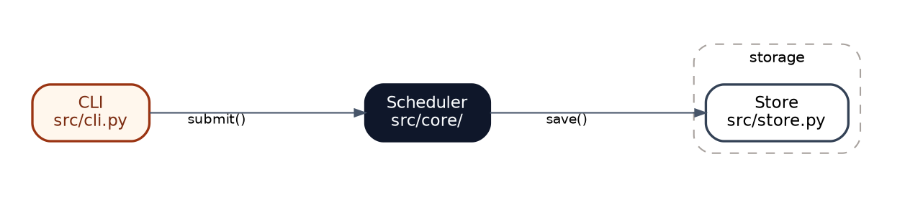

# Diagrams

Rules for architecture diagrams. `improve-architecture` uses this file too.

## Before drawing

- Draw only when a picture shows structure or flow better than text. If a paragraph or a small table carries the same information, use that instead.
- Budget per diagram: at most 9 boxes, 12 arrows, and 2 highlighted boxes. Over budget, split into an overview and detail diagrams; never shrink the text to fit.
- After drafting, remove any box, arrow, or label the diagram still works without, and merge boxes the reader never needs to tell apart.

## Boxes and arrows

- A box is a part of the code: its name on the first line, its path on the second.
- One kind of arrow per diagram: calls, data flow, or dependencies. The caption says which.
- Label an arrow only when the two box names don't already explain it; use the function, message, or table name.
- Color each box by its role, from the table below, and show only the roles a report uses in its legend. The `core` role marks the one or two boxes the diagram is about, usually where the state lives; the caption says why.
- A dashed cluster groups boxes that belong together (a package, a process, a deployment unit); its label names the grouping.

## Roles

The same roles style the boxes in the diagrams and the legend chips in the report (`.box.<role>` in [report.md](report.md)).

| Role | Means | Graphviz attributes |
|---|---|---|
| module | a plain part of the code | the node default |
| `core` | holds the state, or is the subject | `fillcolor="#0f172a", color="#0f172a", fontcolor="#f8fafc"` |
| `entry` | where control comes in: a CLI, an event, a user | `fillcolor="#fff7ed", color="#9a3412", fontcolor="#7c2d12"` |
| `surface` | the public interface other code calls | `fillcolor="#fef3c7", color="#b45309"` |
| `helper` | derived or supporting code | `fillcolor="#e2e8f0", color="#64748b"` |
| `ext` | outside the repo: the OS, another program, a service | `fillcolor="#f1f5f9", color="#94a3b8", fontcolor="#475569"` |
| `seam` | an interface with swappable implementations | `style="rounded,filled,dashed"` |

`improve-architecture` adds three more: deleted (`fillcolor="#fff1f2", color="#e11d48", fontcolor="#9f1239"`), added or moved (`fillcolor="#ecfdf5", color="#059669", fontcolor="#064e3b"`), and a leak across a seam as a red edge (`color="#dc2626", penwidth=2`).

## Graphviz

Start every diagram from this header:



- `splines=ortho` draws right-angle connectors but ignores `label`; label edges with `xlabel`. The wide `ranksep` and the trailing space in each `xlabel` keep labels clear of lines and boxes.
- `rankdir=LR` suits flows; `rankdir=TB` suits layers.
- Render with `dot -Tsvg_inline <name>.dot -o <name>.svg`; that output has no XML header and can be pasted straight into HTML.

### Numbered flows

Graphviz has no sequence diagrams. To trace a path, draw only the boxes the path touches, top to bottom (`rankdir=TB`, so the diagram fits the narrow column beside its steps), and number the edge labels in order (`xlabel="1 submit() "`, `xlabel="2 save() "`). Next to the diagram, list the same numbered steps, one sentence each, saying what happens and where (`src/core/run.py:88`).

### Hand-built SVG

Use hand-written SVG only for visuals Graphviz cannot lay out, such as `improve-architecture`'s mass diagrams. Keep the same colors and font.

## Check what you drew

Screenshot the assembled report and read the image:

```bash
firefox --headless --no-remote --profile /tmp/claude/ff-profile --window-size=1200,900 --screenshot /tmp/claude/architecture/<slug>/shot.png file:///tmp/claude/architecture/<slug>/report.html
```

The profile directory must exist before the first run, and the command fails inside the Bash sandbox, so run it outside the sandbox. The screenshot covers only the window, not the whole page; raise the height in `--window-size` (about 1000 px per section) until the bottom of the report shows.

Look for labels that overlap lines or boxes, text too small to read at page width, arrows that run behind unrelated boxes, and diagrams wider than the page. Fix the `.dot` file, re-render, and look again.
